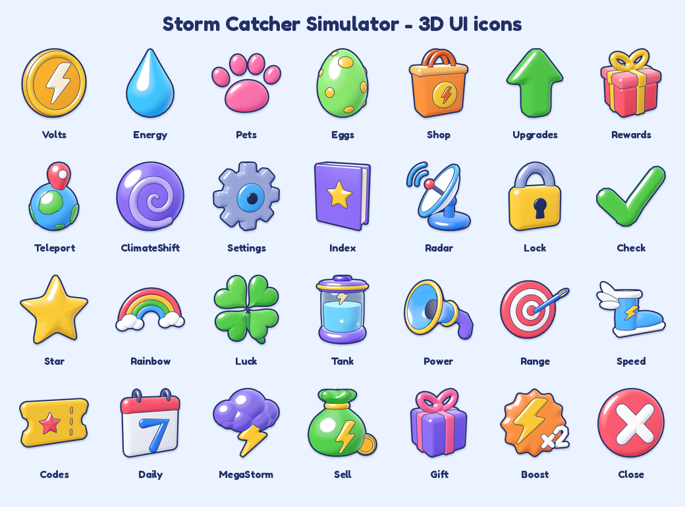
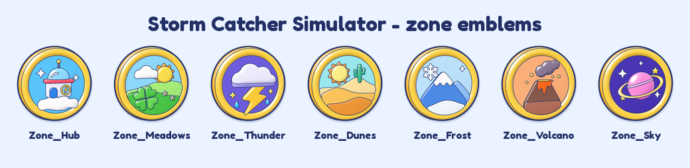
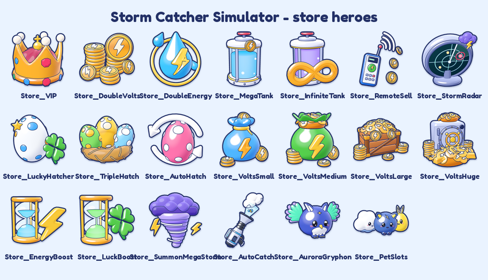

# 3D UI icons

The game's interface icons (docs/STYLE_GUIDE.md, "Icons") are small, chunky 3D objects modelled in
Trimble SketchUp and rendered as glossy cartoon PNGs: soft toon shading, a glossy highlight and a bright
rim, a 7 px Ink (`#233066`) outline around the silhouette, thin Ink lines between parts and a soft drop
shadow inside the canvas. Each one is 512 x 512 RGBA with a transparent background, shot from its own 3/4
hero angle, and they are designed to read at 48 px.



| Key | Object | Key | Object |
| --- | --- | --- | --- |
| Volts | gold coin with an embossed bolt | Luck | four-leaf clover |
| Energy | raindrop | Tank | storm jar |
| Pets | paw | Power | vacuum nozzle |
| Eggs | spotted egg | Range | target with a dart |
| Shop | shopping bag | Speed | winged boot |
| Upgrades | fat up arrow | Codes | ticket |
| Rewards | gift box with a bow | Daily | calendar |
| Teleport | map pin on a mini globe | MegaStorm | thundercloud with a bolt |
| ClimateShift | purple swirl | Sell | coin bag |
| Settings | gear | Gift | small present |
| Index | book | Boost | x2 lightning badge |
| Radar | radar dish | Close | red round X |
| Lock | padlock | Star | star |
| Check | check mark | Rainbow | rainbow on clouds |

## Files

| Path | What |
| --- | --- |
| `tools/icons/sketchup_icons.py` | the SketchUp models: 11 `# ===== chunk` blocks (2 of helpers, 9 of icons), one group `Prop_<Key>` per icon, pieces grouped by paint (`Color_RRGGBB`, `Glass_RRGGBB`, `Neon_FFFFFF` for shine streaks) |
| `tools/icons/import_icons.py` | offline dry run, import of a SketchUp extraction, checks |
| `tools/icons/render_icons.py` | source → GLB → headless Chromium → finished PNGs, contact sheet, 48 px check |
| `tools/icons/viewer.html` | three.js renderer: the shaded view next to a paint-id/depth pass |
| `assets/source/world/icons.json` | the extracted SketchUp polygons (format `storm-icons-source/1`; the world prop pack skips it) |
| `assets/source/world/StormIcons.skp` | the SketchUp model the source came from |
| `assets/ui/icons3d/<Key>.png` | the finished icons |
| `assets/ui/icons3d/_sheet.png` | contact sheet on Mist, 128 px per icon |
| `build/icons/check48.png` | (not committed) the icons at 48 px on Mist, in the white HUD badge and on the Sky band, 1:1 and enlarged |

The models use the world prop kit's helper library, `tools/world/sketchup/lib.py`, and its extractor,
`tools/world/sketchup/extract.py` (see `tools/world/README.md`).

## Re-render the PNGs (no SketchUp needed)

Requirements: Python 3.9+ with numpy and Pillow, three.js (`npm install` in `tools/world`), and Chrome or
Chromium. The browser is found through `CHROME_PATH`, Playwright's headless shell
(`/opt/pw-browsers` or `~/.cache/ms-playwright`) or a system Chrome.

```sh
python3 tools/icons/render_icons.py                    # every icon + _sheet.png + build/icons/check48.png
python3 tools/icons/render_icons.py --icons Volts,Star # only these (the sheet is rebuilt from what exists)
```

Rendering is deterministic: the same source gives byte-identical PNGs.

Look tweaks that need no remodelling:

* **Angle and framing per icon:** the `ICONS` table in `render_icons.py` (`yaw` turns the camera to the
  icon's right, `pitch` raises it, `roll` tilts the frame, `fill` is the share of the frame the icon
  spans). Defaults are in `VIEW`.
* **Outline, part lines and shadow:** `OUTLINE_PX`, `LINE_PX` and `SHADOW` in `render_icons.py`.
* **Shading** (toon terminator, shadow tint, highlight, rim): `viewer.html`. You can open it in a normal
  browser: serve the repo root (`python3 -m http.server`) and go to
  `/tools/icons/viewer.html?icon=Volts&glb=/build/icons/StormIcons.glb`.

## Change or add a model

1. **Edit `tools/icons/sketchup_icons.py`.** Model each icon about 4–5 studs across with its readable face
   towards −Y, using the helpers in chunks 1–2 (`IC`) and `lib.py` (`L`). Keep it chunky: no thin parts,
   one idea per icon. Use palette paints from `P`. A new icon also needs an entry in `ICONS` in
   `render_icons.py` (and a key in `src/client/UI/Icons.luau` to be used in the game). Keep every chunk
   under ~200 lines and follow the sandbox rules in the file header (no imports, no eval/exec/open, no
   dunders, no classes).
2. **Iterate offline.** This runs `lib.py`, the icon script and `extract.py` in the SketchUp stand-in
   (`tools/world/offline_sketchup.py`) and renders the result to `build/icons/offline/`:

   ```sh
   python3 tools/icons/import_icons.py offline
   python3 tools/icons/render_icons.py --source build/icons/offline/icons.json --icons Volts
   ```

   Open the PNGs and `build/icons/offline/check48.png` and repeat until the icon looks right at 512 px
   and still reads at 48 px.
3. **Build it in SketchUp** (Trimble SketchUp MCP). Read the baseline skills first (`list_skills`,
   `read_skill`). Then, with `build_model`:
   * send `tools/world/sketchup/lib.py` one `# ===== chunk` at a time (4 calls; the first with
     `clean: true`),
   * then send `tools/icons/sketchup_icons.py` one chunk at a time, in order (11 calls; chunk 1 stores the
     helpers in `session_state["IC"]`),
   * then send `tools/world/sketchup/extract.py` with `ONLY = [...]` set to a batch of icon keys. The
     whole set is about 1.8 MB of polygons, so it was pulled in three batches and each full tool result
     was saved to a file:
     1. Volts, Energy, Star, Check, Close, Pets, Eggs, Luck, Shop, Codes, Upgrades
     2. Sell, Boost, Power, Rewards, Gift, Teleport, ClimateShift, Index
     3. Settings, Daily, Lock, Radar, Range, Speed, Rainbow, MegaStorm, Tank
4. **Import** each saved result (`--replace` on the first so the file holds only SketchUp output):

   ```sh
   python3 tools/icons/import_icons.py import batch1.txt --replace
   python3 tools/icons/import_icons.py import batch2.txt
   python3 tools/icons/import_icons.py import batch3.txt
   ```

   To update a single icon, extract only that key and import it without `--replace`.
5. **Save the model** with `save_model` as `assets/source/world/StormIcons.skp`.
6. **Render** with `python3 tools/icons/render_icons.py` and compare with the offline renders. In the last
   build the SketchUp extraction was byte-identical to the offline dry run.

## Checks

```sh
python3 tools/icons/import_icons.py check     # sandbox safety, dry run, faces, source + PNGs complete
python3 tools/world/build_world_pack.py --check  # the world prop pack is unaffected by icons.json
```

## Using the icons in the game

`src/client/UI/Icons.luau` maps each key to an uploaded image id and an emoji fallback, so the game works
before the images are uploaded. Upload `assets/ui/icons3d/<Key>.png` to Roblox as images (Creator Hub or
Open Cloud) and put each asset id in its key's `Id`. `tools/preview_ui.py` then draws the matching repo
picture for that id.

## Zone emblems

One chunky medallion per region of `src/shared/Config/Zones.luau` (the hub and the six zones), keyed
`Zone_<Zone Key>`: a thick gold coin rim around an enamel face in the biome palette, with a bold raised
symbol of the biome on it. They are made with the same kit, look and pipeline as the icons above and are
shown on the zone title card (`src/client/UI/Overlays/ZoneTitle.luau`).



| Key | Region | Symbol |
| --- | --- | --- |
| Zone_Hub | Storm Station | domed lab with a porthole, on a cloud |
| Zone_Meadows | Sunny Plains | sun over green hills and a clover |
| Zone_Thunder | Thunder Valley | thundercloud with a bolt and raindrops |
| Zone_Dunes | Dune Sea | dune bands, sun and a cactus |
| Zone_Frost | Frostpeak | snowy peak with a snowflake |
| Zone_Volcano | Ashfall Volcano | volcano with lava and an ash cloud |
| Zone_Sky | Upper Atmosphere | ringed planet with stars |

| Path | What |
| --- | --- |
| `tools/icons/sketchup_zone_emblems.py` | the SketchUp models: 4 `# ===== chunk` blocks (chunk 1 = the emblem helpers in `session_state["ZE"]`), one group `Prop_Zone_<Key>` per emblem; built on the icon helpers (chunks 1–2 of `sketchup_icons.py`) |
| `assets/source/world/zone_emblems.json` | the extracted SketchUp polygons (`storm-icons-source/1`) |
| `assets/source/world/StormZoneEmblems.skp` | the SketchUp model |
| `assets/ui/icons3d/Zone_<Key>.png` | the finished 512 px emblems; `_zones.png` is their contact sheet |

Every command above takes `--set zones` to work on the emblems instead of the icons:

```sh
python3 tools/icons/import_icons.py --set zones offline         # dry run -> build/icons/zones/offline/icons.json
python3 tools/icons/render_icons.py --set zones --source build/icons/zones/offline/icons.json
python3 tools/icons/render_icons.py --set zones                 # the committed source -> Zone_<Key>.png + _zones.png
```

SketchUp build order (`build_model`): `tools/world/sketchup/lib.py` (4 chunks, the first with `clean: true`),
chunks 1–2 of `tools/icons/sketchup_icons.py`, the 4 chunks of `sketchup_zone_emblems.py`, then
`tools/world/sketchup/extract.py` in three batches (`ONLY = ["Zone_Hub", "Zone_Meadows"]`,
`["Zone_Thunder", "Zone_Dunes", "Zone_Frost"]`, `["Zone_Volcano", "Zone_Sky"]`), each saved to a file and
imported with `python3 tools/icons/import_icons.py --set zones import <file>` (`--replace` on the first);
then `save_model` as `StormZoneEmblems.skp`. In the last build the extraction was identical to the offline
dry run.

In the game: `Icons.luau` has a `Zone_<Key>` line per emblem (uploaded with
`python3 tools/roblox/upload_icons.py --only Zone_Hub,Zone_Meadows,Zone_Thunder,Zone_Dunes,Zone_Frost,Zone_Volcano,Zone_Sky`),
and a new zone needs a `Zone_<Key>` model, an entry in `ZONE_ICONS` in `render_icons.py` and a line in
`Icons.luau` (until then the title card shows the zone's emoji on a round badge).

## Store icons

The gamepass and developer product icons (`assets/gamepasses/<Key>.png`, `assets/products/<Key>.png`, one per key
of `src/shared/Config/Monetization.luau`; the in-game Shop shows the same pictures as its card art) are sunburst
badges built around a big glossy **3D hero model** of the item. The heroes are more detailed than the 48 px UI
icons (jewels, coin stacks, rivets, straws, glass with glowing liquid) and are rendered at 1024 px with the same
toon shading, Ink outline and part lines, plus three store-only touches of `viewer.html`: polished-metal gold and
steel (`metal`), soft velvet/straw/wood (`matte`) and clearer glass (`glass`, `clear`; the outline stays outside
see-through glass). `assets/source/store3d.html` then lays out each badge: the item's colour as a sunburst, a soft
glow and contact shadow, the hero, sparkles and chunky candy labels with thick Ink outlines (everything that
matters inside the centred circle of radius ~430 on the 1024 grid, because Roblox crops pass icons to a circle).



| Key | Hero | Label |
| --- | --- | --- |
| VIP | jewelled gold crown with a velvet cushion and pearl tips | VIP |
| DoubleVolts | stacks of volt coins and a big coin flipping in front | 2X |
| DoubleEnergy | glowing energy drop with an embossed bolt and an energy ring | 2X |
| AutoCatch | the game's Storm Vacuum (gear.py `VacuumGun`) sucking a cloud through a glowing beam | AUTO |
| RemoteSell | handheld remote beaming radio waves and coins | AUTO SELL |
| MegaTank | big storm tank: glass drum, glowing cyan liquid, gold trim, valve wheel | 2X |
| InfiniteTank | the storm tank full of violet glow with a big gold infinity sign | INFINITE |
| LuckyHatcher | spotted egg with a four-leaf clover and a gold star | +50% |
| TripleHatch | three spotted eggs in a straw nest | X3 |
| AutoHatch | pink egg circled by two fat arrows | AUTO |
| PetSlots | three real pets: Puffling, Thunder Pup, Zappy (`tools/pets`) | +3 SLOTS |
| StormRadar | radar scope with a glowing sweep, blips and a storm cloud popping out | RADAR |
| VoltsSmall | small blue pouch of volts with spilled coins | |
| VoltsMedium | open money sack full of coins | |
| VoltsLarge | wooden crate overflowing with coins | |
| VoltsHuge | steel vault with a heap of coins, stacks and gold bars | BEST VALUE |
| EnergyBoost | hourglass with glowing blue sand and a lightning bolt | 2X, 30 MIN |
| LuckBoost | hourglass with glowing green sand and a clover | 2X, 30 MIN |
| SummonMegaStorm | swirling tornado under a purple thundercloud with lightning | SUMMON |
| AuroraGryphon | the real Aurora Gryphon pet (`tools/pets`) under aurora lights | EXCLUSIVE |

| Path | What |
| --- | --- |
| `tools/icons/sketchup_store_icons.py` | the SketchUp models: 10 `# ===== chunk` blocks (2 of store helpers in `session_state["ST"]`, 8 of heroes), one group `Prop_Store_<Key>` per hero; built on the icon helpers (chunks 1–2 of `sketchup_icons.py`) |
| `tools/icons/store_scenes.py` | heroes made from the game's own models: the pets (`tools/pets/pet_geometry.py`) for AuroraGryphon and PetSlots, and the Storm Vacuum (`assets/source/world/gear.json`) added to Store_AutoCatch (`GUN` must stay in step with `NOZZLE` in chunk 10) |
| `tools/icons/digest.py` | a short digest of an extraction, sent in the same `build_model` call as `extract.py` to check the SketchUp model against the dry run without pulling megabytes of polygons |
| `assets/source/world/store_icons.json` | the extracted SketchUp polygons (`storm-icons-source/1`) |
| `assets/source/world/StormStoreIcons.skp` | the SketchUp model |
| `assets/source/store3d/Store_<Key>.png` | the 1024 px hero renders; `_sheet.png` is their contact sheet |
| `assets/source/store3d.html`, `store3d.js` | the badge layouts (per-item colours, hero placement, labels) and their drawing helpers (on top of `art.js`) |

### Rebuild

```sh
python3 tools/icons/import_icons.py --set store offline          # dry run -> build/icons/store/offline/icons.json
python3 tools/icons/render_icons.py --set store --source build/icons/store/offline/icons.json --size 512   # quick look
python3 tools/icons/render_icons.py --set store                  # the committed source -> assets/source/store3d (1024 px, ~2 min a hero)
python3 tools/render_art.py gamepasses products                  # the badges -> assets/gamepasses, assets/products
python3 tools/roblox/upload_store_icons.py --only VIP,DoubleVolts,... --force   # the Shop's card art (see below)
```

Angles, framing and the store shading options per hero are in `STORE_ICONS` in `render_icons.py`; badge colours,
hero placement and labels in `D` in `store3d.html`.

SketchUp build order (`build_model`): `tools/world/sketchup/lib.py` (4 chunks, the first with `clean: true`),
chunks 1–2 of `tools/icons/sketchup_icons.py`, the 10 chunks of `sketchup_store_icons.py` (consecutive chunks may
share a call), then `tools/world/sketchup/extract.py` followed by `tools/icons/digest.py` as ONE call. Save that
result to a file and run `python3 tools/icons/import_icons.py --set store verify <file>`: it runs the same two
scripts on the dry run and reports, per hero, whether SketchUp built exactly the same polygons. Then pull the
polygons with `extract.py` in batches (`ONLY = [...]`, about 1.5 MB each: `[VIP, DoubleVolts, DoubleEnergy,
MegaTank, InfiniteTank, AutoCatch]`, `[RemoteSell, StormRadar, LuckyHatcher, TripleHatch, AutoHatch]`,
`[VoltsSmall, VoltsMedium, EnergyBoost, LuckBoost, SummonMegaStorm]`, `[VoltsLarge, VoltsHuge]`, all keys
`Store_`-prefixed), save each result and import them with `python3 tools/icons/import_icons.py --set store import
<file>` (`--replace` on the first). Finish with `save_model` as `StormStoreIcons.skp`. In the last build the
digest matched for all 18 heroes and the imported source was byte-identical to the dry run.

A new item needs a hero (a chunk function, or a scene in `store_scenes.py`), an entry in `STORE_ICONS`, a design in
`D` in `store3d.html` and its key in `PASSES` / `PRODUCTS` in `tools/render_art.py`.

### In the game

`python3 tools/roblox/upload_store_icons.py --only <keys> --force` uploads the badges as images and writes each id
into the item's `Image =` line in `Monetization.luau` (the Shop draws the badge once Roblox has approved it). Pass
the badge keys with `--only`: a plain `--force` would also upload the Shop's sunburst and Robux pieces again. The
pass and product icons on the Creator Dashboard are uploaded by hand (`docs/STORE_LISTING.md`).
